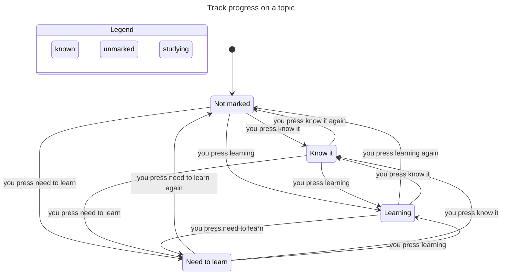

# Progress verification

| Skill | What it checks | Tool |
| --- | --- | --- |
| [verify-progress-tabs](../../.claude/skills/verify-progress-tabs/SKILL.md) | Progress marked in one tab is never erased by another | TLA+ / TLC, 73 states, plus `tests/progress-tabs.test.ts` |

The model found that each tab saved its whole stale copy of the progress map, so marks made in another tab were lost. Marks now change one node in storage, and tabs reload on `storage` events.

## Track progress on a topic

Generated with pstack `/statechart` from [TrackProgress.tla](flows/track-progress/TrackProgress.tla) ([TLC report](flows/track-progress/report.md)). Pressing the current mark again clears it.

